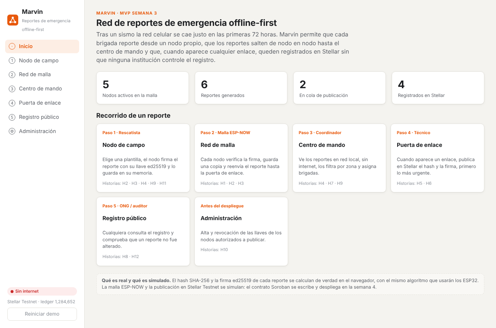
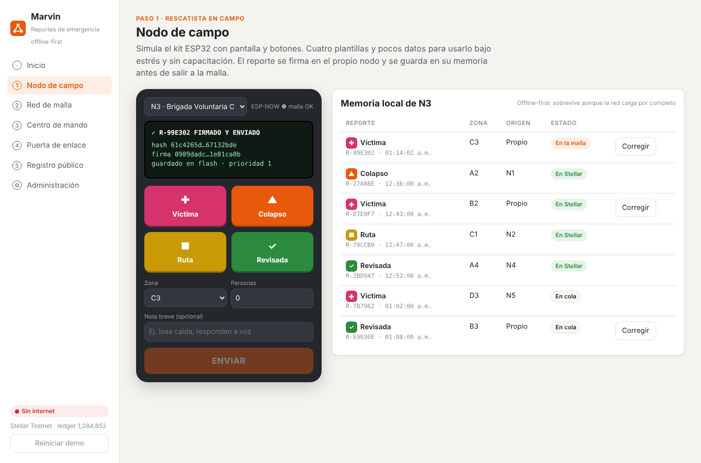
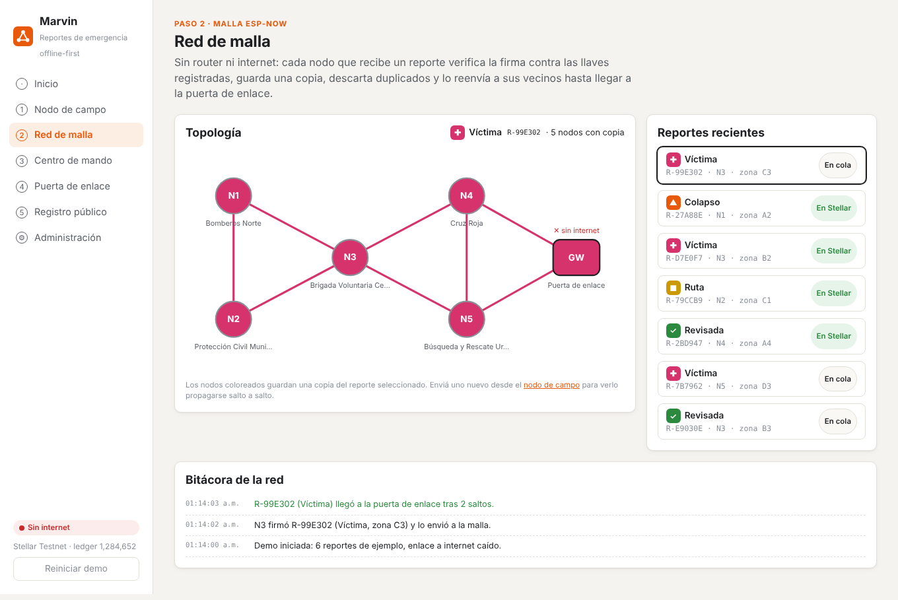
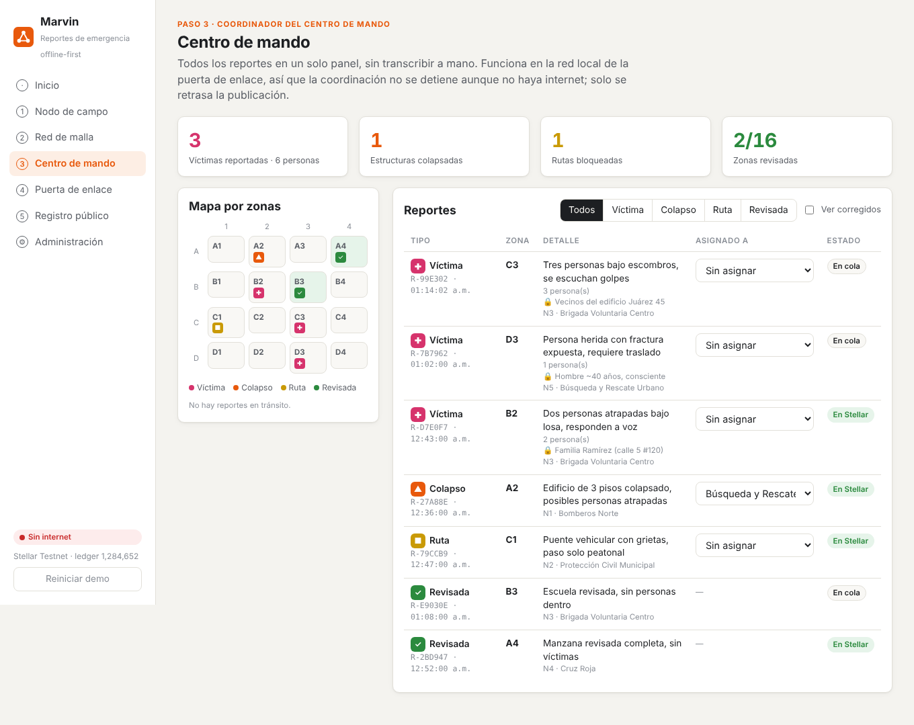
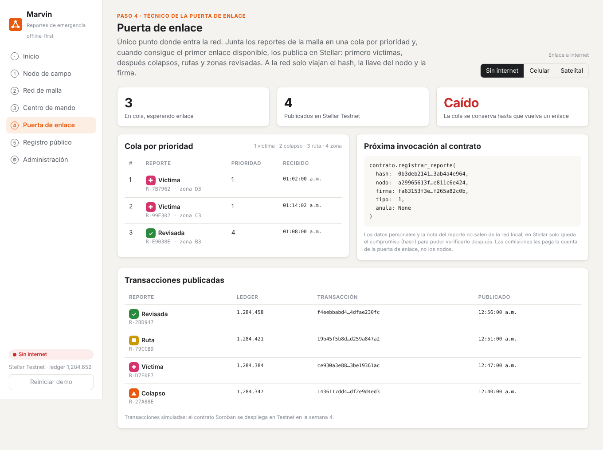
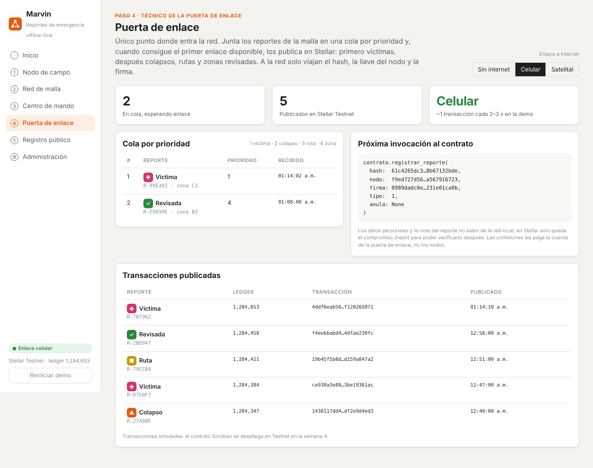
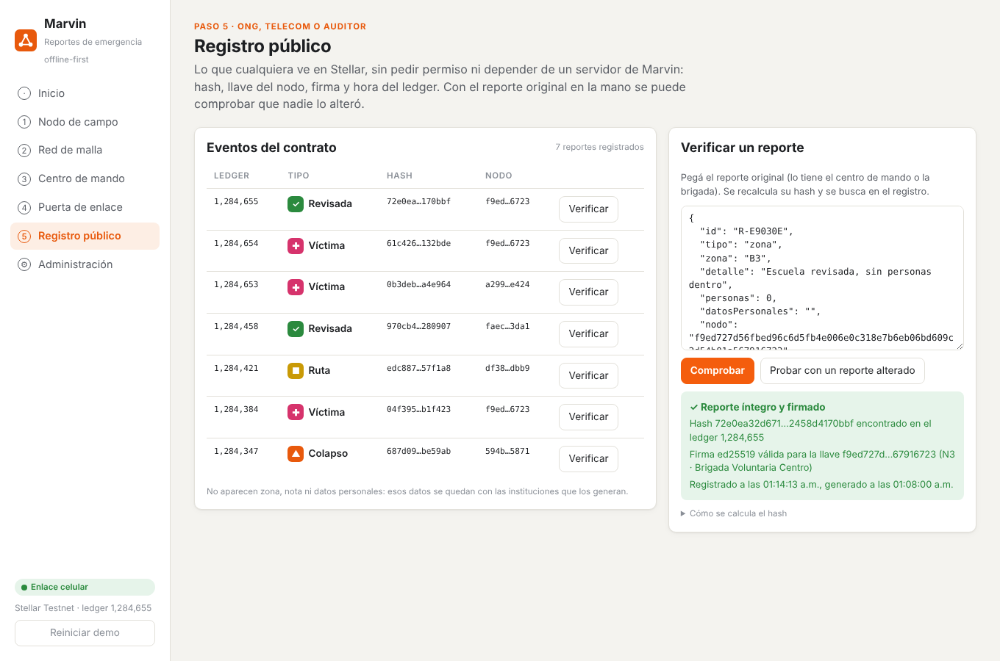
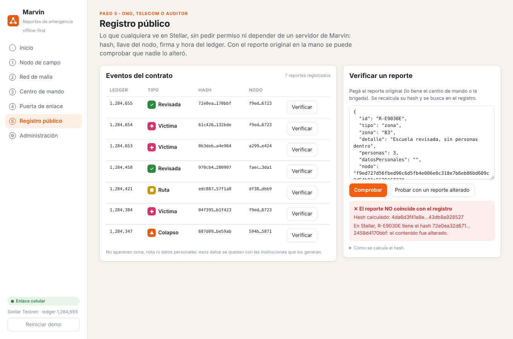
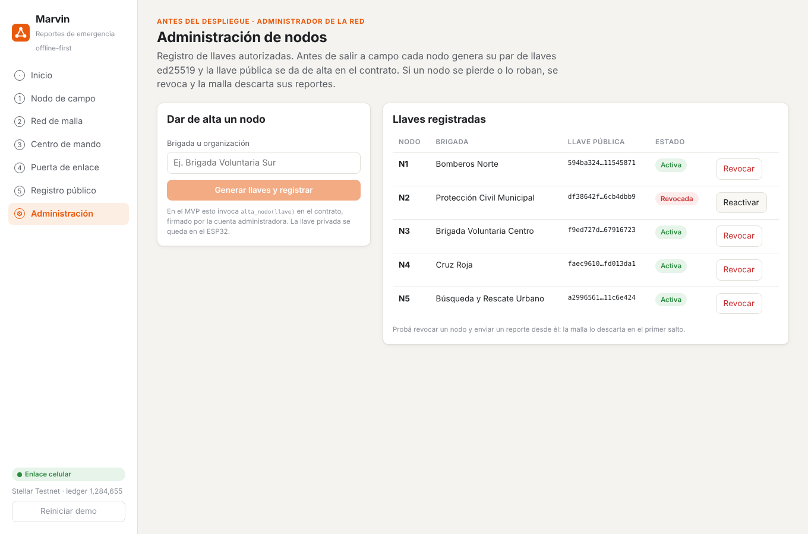
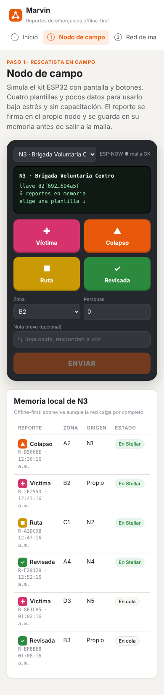

# Documentación — Semana 3: Functional Proof

**Proyecto:** Marvin — Red de reportes de emergencia offline-first
**Repositorio:** [migux97/Marvin](https://github.com/migux97/Marvin) · front en [`frontend/`](../../frontend) · cómo correrlo en el [README](../../README.md)

---

## 1. Front construido

### Qué construimos

El front es una aplicación web (React + Vite + TypeScript) que recorre el flujo principal del MVP definido en el [Product Blueprint](../semana2/ProductBlueprint.md): un reporte nace en el nodo de un rescatista sin señal, viaja por la malla, llega al centro de mando, se publica en Stellar cuando aparece un enlace y cualquiera puede verificarlo después. Cada pantalla corresponde a un paso del flujo de usuario del Blueprint (sección 3) y a un rol concreto, y todas comparten el mismo estado, así que lo que se hace en una pantalla se ve en las demás en tiempo real.

Para que la demostración sea creíble y sirva de base para la semana 4, separamos lo real de lo simulado:

- **Real:** el hash SHA-256 de cada reporte (sobre una serialización canónica con claves en orden fijo) y la firma ed25519 del nodo de origen se calculan en el navegador con `@noble/ed25519` y `@noble/hashes`, el mismo algoritmo que usarán los ESP32. La verificación de firmas en cada salto y en el registro público también es real.
- **Simulado:** la malla ESP-NOW (la propagación salto a salto se anima con un temporizador sobre una topología fija de cinco nodos y una puerta de enlace) y la publicación en Stellar Testnet (el ledger y el hash de transacción son ficticios). El contrato Soroban se escribe y despliega la semana 4; el front ya muestra la invocación exacta que hará la puerta de enlace.

El estado se guarda en el `localStorage` del navegador para que la demo sobreviva a una recarga, y el botón **Reiniciar demo** vuelve a los seis reportes de ejemplo.

### Pantallas y conexión con el MVP

| # | Pantalla | Rol (Blueprint) | Historias del backlog | Qué demuestra |
| :-: | --- | --- | --- | --- |
| — | Inicio | Todos | — | Resumen del producto, contadores y el recorrido de un reporte en seis pasos. |
| 1 | Nodo de campo | Rescatista | H2, H3, H4, H9, H11 | Plantillas, firma en origen, memoria local y corrección de reportes. |
| 2 | Red de malla | Nodos intermedios | H1, H2, H3 | Propagación salto a salto, copias en cada nodo y bitácora de la red. |
| 3 | Centro de mando | Coordinador | H4, H7, H9 | Panel único con mapa por zonas, filtros y asignación de brigadas. |
| 4 | Puerta de enlace | Técnico de la puerta de enlace | H5, H6 | Cola por prioridad y publicación cuando aparece un enlace. |
| 5 | Registro público | ONG, telecom, auditor | H8, H12 | Consulta sin permiso y verificación de integridad de un reporte. |
| ⚙ | Administración | Administrador de la red | H10 | Alta y revocación de llaves de nodos. |

#### Inicio



Presenta el problema en una frase, cuatro contadores (nodos activos, reportes generados, en cola y registrados en Stellar) y tarjetas con los seis pasos del flujo, cada una con las historias del backlog que cubre. Un aviso deja claro qué parte es real y qué parte es simulada.

#### 1. Nodo de campo



Imita el kit ESP32 con pantalla y botones. El rescatista elige el nodo (cada uno pertenece a una brigada), toca una de las cuatro plantillas del MVP —víctima, colapso, ruta bloqueada, zona revisada—, indica la zona y el número de personas y, si quiere, una nota breve. Solo en las víctimas aparece un campo de datos personales, marcado como cifrado y fuera de Stellar (H6). Al pulsar **Enviar**, el nodo calcula el hash, lo firma con su llave privada y muestra en la pantalla el hash, la firma y la prioridad. La tabla de la derecha es la **memoria local del nodo** (H2): todo lo que generó o recibió por la malla, con su estado. Los reportes propios tienen el botón **Corregir**, que crea un reporte nuevo que anula al anterior sin borrarlo (H9). La interfaz usa botones grandes y pocos campos para que se pueda usar bajo estrés y sin capacitación (H11).

#### 2. Red de malla



Muestra la topología (cinco nodos y la puerta de enlace) y, para el reporte seleccionado, qué nodos ya guardan una copia y por qué enlaces viajó. En cada salto el nodo verifica la firma contra las llaves registradas y descarta duplicados (H1, H3); si el nodo de origen está revocado, el reporte se descarta en el primer salto. La puerta de enlace indica si hay o no internet. Debajo, la **bitácora de la red** registra cada evento: firmas, llegadas a la puerta de enlace con el número de saltos, publicaciones, altas y revocaciones.

#### 3. Centro de mando



Es el panel del coordinador (H7). Funciona en la red local de la puerta de enlace, así que muestra los reportes en cuanto llegan, aunque todavía no se hayan publicado en Stellar. Tiene cuatro indicadores (víctimas y personas, colapsos, rutas bloqueadas, zonas revisadas sobre 16), un **mapa por zonas** de 4×4 en el que cada celda muestra los reportes vigentes y se pinta de verde cuando la zona está revisada (H4, para no duplicar esfuerzos), y una tabla ordenada por prioridad con filtros por tipo y por zona. Desde la tabla se asigna una brigada a cada incidente. Los reportes corregidos desaparecen del panorama y se pueden ver tachados con **Ver corregidos** (H9).

#### 4. Puerta de enlace




El selector de enlace (sin internet, celular, satelital) simula que la conectividad aparece y desaparece. Sin enlace, los reportes se acumulan en una **cola por prioridad** (1 víctima, 2 colapso, 3 ruta, 4 zona revisada); al activar un enlace se publican uno por uno empezando por lo más urgente (H5). El panel **Próxima invocación al contrato** muestra exactamente qué se enviará a Stellar —hash, llave del nodo, firma, tipo y, si corresponde, el reporte que anula— y deja claro que la nota y los datos personales no salen de la red local (H6). Abajo se listan las transacciones publicadas con su ledger.

#### 5. Registro público




Es lo que vería cualquier ONG, operadora o auditor leyendo los eventos del contrato: ledger, tipo, hash y llave del nodo, sin zona, nota ni datos personales (H8). La herramienta **Verificar un reporte** recibe el reporte original en JSON, recalcula su hash, lo busca en el registro y verifica la firma ed25519 contra la llave del nodo (H12). El botón **Probar con un reporte alterado** cambia un dato (el número de personas) y muestra que el hash ya no coincide con el registrado: esa es la garantía de inmutabilidad que justifica usar Stellar.

#### Administración



Permite dar de alta un nodo (genera un par de llaves ed25519 y lo conecta a la malla) y revocar o reactivar llaves (H10). Si se revoca un nodo y se envía un reporte desde él, la malla lo marca como **Rechazado** en el primer salto.

#### Vista móvil



El diseño es adaptable: en pantallas angostas la navegación pasa a una barra horizontal y las columnas se apilan, pensando en que el panel se consulte desde un teléfono o una tableta en el puesto de mando.

### Recorrido sugerido para probarlo (3 minutos)

1. **Nodo de campo:** elegir N3, tocar **Víctima**, zona C3, 3 personas, y **Enviar**.
2. **Red de malla:** ver cómo el reporte salta de N3 a N4 y N5 y llega a la puerta de enlace.
3. **Centro de mando:** el reporte aparece en C3, arriba de la tabla, con estado *En cola*; asignarle una brigada.
4. **Puerta de enlace:** cambiar a **Celular** y ver que la víctima se publica antes que la zona revisada.
5. **Registro público:** **Verificar** el reporte y luego **Probar con un reporte alterado**.
6. **Administración:** revocar N1, volver al nodo de campo y enviar algo desde N1: queda rechazado.

### Estructura del código

```
frontend/
├── public/marvin.svg
└── src/
    ├── lib/
    │   ├── model.ts      tipos, plantillas, prioridades, topología y serialización canónica
    │   ├── crypto.ts     SHA-256 y firma/verificación ed25519 (reales)
    │   └── store.tsx     estado global, simulación de la malla y de la publicación
    ├── components/       Layout (navegación) y componentes de interfaz
    └── pages/            Inicio, Nodo, Malla, Mando, Gateway, Registro, Admin
```

---

## 2. Decisión técnica

**Opción elegida: A. Contrato propio (Soroban).**

**Qué hará el contrato.** Un único contrato de Marvin en Testnet con dos responsabilidades, tal como se definió en la sección 8 del Blueprint:

1. **Registro de nodos autorizados.** `alta_nodo(llave)` y `revocar_nodo(llave)`, que solo puede invocar la cuenta administradora. Guarda qué llaves ed25519 pueden publicar reportes.
2. **Registro de reportes.** `registrar_reporte(hash, llave, firma, tipo, anula)`, que invoca la puerta de enlace. El contrato comprueba que la llave esté activa, verifica la firma ed25519 del nodo sobre el hash con la función nativa de Soroban (`env.crypto().ed25519_verify`), rechaza hashes duplicados y emite un evento con el hash, la llave, el tipo, el reporte que anula y la hora del ledger. Una función de consulta permite saber si un hash está registrado y por qué nodo.

Lo que se escribe en la red es mínimo (32 bytes de hash, la llave y la firma); nunca la nota ni los datos personales.

**Por qué hace falta un contrato propio.** El valor de Marvin es que las reglas de quién puede publicar y qué firma es válida vivan en la red y no en el servidor de una institución (fricciones 5 y 6 del Problem Brief). Con un contrato, cualquier organización puede comprobar que cada reporte registrado fue firmado por un nodo autorizado y no revocado, sin confiar en quien opera la puerta de enlace. Además, la firma la genera un dispositivo que no tiene cuenta de Stellar, y solo un contrato puede verificar en la red esa firma de un tercero.

**Qué descartamos.**

- **Transacciones simples con `MEMO_HASH`** (32 bytes, cabe un SHA-256) o `manageData`. Es lo más barato y no requiere contrato, pero la red solo sabría que la cuenta de la puerta de enlace publicó un hash: no se verifica la firma del nodo, no hay registro de llaves ni revocación, y quien controle la puerta de enlace podría publicar cualquier cosa. Toda la validación quedaría fuera de la cadena, que es justo el punto único de confianza que queremos eliminar. `manageData`, además, inmoviliza reserva por cada entrada.
- **Herramientas del ecosistema** (anclas, Stellar Asset Contract, plataformas de pagos o de tokenización). Están pensadas para mover valor y Marvin no mueve dinero; ninguna ofrece un registro de dispositivos con verificación de firmas ed25519 externas.

**Riesgos que tendremos en cuenta la semana 4:** el costo de almacenamiento y el TTL de las entradas persistentes (por eso guardaremos lo mínimo y nos apoyaremos en eventos), el límite de operaciones por transacción para publicar en lote y la gestión de la llave administradora.

---

## 3. Participación del equipo

| Integrante | GitHub | Aporte en este entregable |
| --- | --- | --- |
| Franco Alejandro Mamani | [`migux97`](https://github.com/migux97) | Project Lead. Estructura del front, estado compartido y simulación de la malla; integración de las pantallas y documentación grupal. |
| Emanuel Guzman | [`Emanuel250YT`](https://github.com/Emanuel250YT) | Full Stack. Firma y verificación ed25519 y hash canónico (`lib/crypto.ts`); pantallas de Puerta de enlace y Registro público; definición del contrato propio (decisión técnica). |
| Emanuel Conte | _[usuario de GitHub por confirmar]_ | Market. Pantalla del Centro de mando y textos orientados a coordinadores y brigadistas; revisión de la usabilidad bajo estrés. |
| Aldo Duran | [`aldosoriano8911`](https://github.com/aldosoriano8911) | Pantallas de Nodo de campo y Red de malla, basadas en sus historias sobre la malla ESP-NOW y el funcionamiento offline; README. |

> _Ajustar esta tabla al reparto real antes de entregar. Cada integrante debe tener al menos un commit propio esta semana._

---

## 4. Bloqueos y siguiente paso

**Pendiente:**

- La malla ESP-NOW y la publicación en Stellar están simuladas en el navegador; el contrato todavía no existe.
- El cifrado de los datos personales se indica en la interfaz, pero no está implementado.
- Falta confirmar el usuario de GitHub de Emanuel Conte y el canal de coordinación del equipo.
- Falta hospedar el front (Vercel) y cargar el enlace en el campo *Website* de Apex.

**Próximo paso hacia el MVP (semana 4):**

1. Escribir y desplegar en Testnet el contrato Soroban (`alta_nodo`, `revocar_nodo`, `registrar_reporte`, consulta) con sus pruebas.
2. Conectar la Puerta de enlace al contrato con `@stellar/stellar-sdk` y Stellar RPC, y el Registro público a la lectura de eventos reales.
3. En paralelo, prototipar el firmware de dos ESP32 que firmen un reporte y lo envíen por ESP-NOW, para medir el alcance real entre obstáculos (supuesto 1 del Problem Brief).
